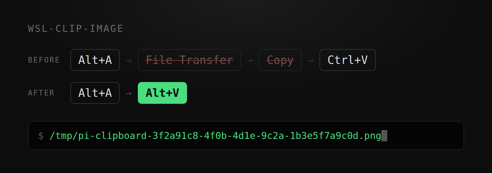

<h1 align="center">wsl-clip-image</h1>

<p align="center">
  <em>스크린샷을 찍고, <code>Alt+V</code>. 끝.</em>
</p>

<p align="center">
  
  
  
  
</p>

<p align="center">
  <strong>4단계가 2단계로.</strong><br>
  <strong>사라진 것: '파일 전송으로 보내기'와 '복사 누르기'.</strong><br>
  <sub>Windows 11 · WSL2 Ubuntu · pi · 실측 82–125 ms</sub>
</p>

<p align="center">
  
</p>

<p align="center">
  <sub><a href="../README.md">English</a> &middot; <a href="README.zh-CN.md">简体中文</a> &middot; <a href="README.zh-TW.md">繁體中文</a> &middot; <a href="README.ja.md">日本語</a> &middot; <a href="README.fr.md">Français</a> &middot; <a href="README.pt-BR.md">Português</a> &middot; <a href="README.ru.md">Русский</a></sub>
</p>

---

## 사라진 두 단계

터미널에서 도는 에이전트에게 오류 창을 보여주고 싶습니다.

`Alt+A`로 영역을 잡고 `Enter`. 이미지는 클립보드에 들어갑니다.

터미널로 돌아와 `Ctrl+V`. 아무 일도 일어나지 않습니다.

그래서 WeChat을 열고 '파일 전송'을 찾아 이미지를 보내고, 나타날 때까지 기다린 뒤 마우스 오른쪽 클릭, '복사'.

다시 터미널로 돌아와 `Ctrl+V`. 이번에는 뭔가 들어옵니다 — `F:\xwechat_files\wxid_xxx\temp\RWTemp\...png` 같은 한 줄입니다.

쓸 수 있고, 에이전트도 이 경로를 읽습니다. 하지만 스크린샷 한 장을 붙이려고 메신저를 열고, 메시지를 한 번 보내고, 복사를 한 번 눌렀습니다.

## 설치 후

```
Alt+A 스크린샷  →  Alt+V  →  /tmp/pi-clipboard-3f2a91c8-....png
```

`Alt+V`를 누르면 프로그램이 직접 클립보드를 읽어 파일로 쓰고, 그 경로를 입력창에 넣습니다.

WeChat `Alt+A`도 되고, Windows 기본 `Win+Shift+S`도 됩니다.

## 설치

```bash
sudo apt install -y wl-clipboard imagemagick
git clone https://github.com/emmett001/wsl-clip-image.git ~/.agents/skills/wsl-clip-image
```

그다음 `Alt+A` → `Enter` → `Alt+V`. pi는 다음 실행 때 이 skill을 읽습니다.

pi 없이 쓰려면 명령 하나면 됩니다:

```console
$ git clone https://github.com/emmett001/wsl-clip-image.git
$ wsl-clip-image/scripts/grab.sh
/tmp/wslclip-20261106-174535-2946895.png
```

`grab.sh`가 출력하는 것은 Linux 경로입니다. `cat`, `identify`, `cp` 모두 그대로 받습니다.

## 검증된 환경

| | |
|-|-|
| 검증됨 | Windows 11 · WSL2 Ubuntu · Windows Terminal · pi 1.5.0 |
| 검증됨 | 같은 구성에서 임의의 스크립트가 `grab.sh`를 호출하는 경우 |
| 미검증 | 다른 에이전트, 다른 터미널, 다른 배포판, WSL1, 네이티브 Linux, macOS |

`Alt+V`는 pi 자체의 키 바인딩입니다. 다른 에이전트는 키도, 이미지 경로를 다루는 방식도 다시 확인해야 합니다.
`grab.sh`는 bash와 시스템 명령에 기대므로 옮기기 쉽습니다. 다만 실측은 아직입니다.

## 숫자

같은 1920x1020 스크린샷, 같은 머신에서 측정:

| 경로 | 시간 |
|-|-|
| `wl-paste` (pi 내부) | 82–125 ms |
| `wl-paste` + ImageMagick (`grab.sh`) | 210 ms |
| PowerShell 대체 경로 | 660–1709 ms |

빠르고 느린 경계는 `wl-clipboard`입니다. 5–17배 차이입니다.

## 붙지 않을 때

```console
$ scripts/doctor.sh
== 1. WSL interop ==          ok  binfmt WSLInterop 등록됨
== 2. powershell.exe ==       ok  실행 가능
== 3. WSL 클립보드 도구 ==    ok  wl-paste 있음, 빠른 경로 사용 가능: image/bmp
== 4. Windows 클립보드 ==     ok  이미지 가져옴, 82 ms
결론: 경로 사용 가능
```

| 증상 | 대응 |
|-|-|
| `Exec format error` 또는 `xxx.exe: 1: MZ...: not found` | `scripts/doctor.sh --fix` |
| '클립보드에 이미지가 없습니다' | 스크린샷이 완료되지 않았거나, 다른 프로그램이 단축키를 가져갔음 |
| `Alt+V`에 1–2초 걸림 | `sudo apt install -y wl-clipboard` |
| 이미지가 가끔 '만료됨' | 클립보드를 제공하던 프로세스가 종료됨. 다시 캡처 |

헷갈리기 쉬운 두 가지:

| 흔한 오해 | 실제로 일어나는 일 |
|-|-|
| 스크린샷이 파일 형태로 클립보드에 저장됨 | 저장되는 것은 비트맵. 파일 경로는 '보낸 뒤 복사'를 해야 나타남 |
| 먼저 파일 전송으로 보내야 붙는다 | `Enter`를 누른 그 순간 클립보드에 이미 들어 있음 |

## 범위 밖

클립보드 기록과 검색, 텍스트 복사, WSL의 이미지를 Windows로 보내는 기능.

## 라이선스

[MIT](../LICENSE)
