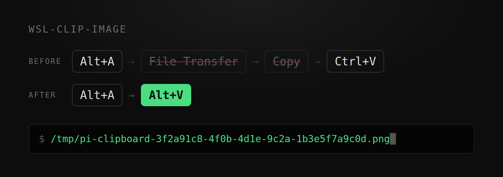

<h1 align="center">wsl-clip-image</h1>

<p align="center">
  <em>Tire um print, depois <code>Alt+V</code>. Só isso.</em>
</p>

<p align="center">
  
  
  
  
</p>

<p align="center">
  <strong>Quatro passos viram dois.</strong><br>
  <strong>Saíram: "enviar para Transferência de arquivos" e "clicar em Copiar".</strong><br>
  <sub>Windows 11 · WSL2 Ubuntu · pi · 82–125 ms medidos</sub>
</p>

<p align="center">
  
</p>

<p align="center">
  <sub><a href="../README.md">English</a> &middot; <a href="README.zh-CN.md">简体中文</a> &middot; <a href="README.zh-TW.md">繁體中文</a> &middot; <a href="README.ja.md">日本語</a> &middot; <a href="README.ko.md">한국어</a> &middot; <a href="README.fr.md">Français</a> &middot; <a href="README.ru.md">Русский</a></sub>
</p>

---

## Os dois passos a mais

Você quer mostrar uma caixa de erro para o agente que roda no seu terminal.

`Alt+A`, você desenha a área, `Enter`. A imagem está na área de transferência.

De volta ao terminal, `Ctrl+V`. Nada acontece.

Então você abre o WeChat, encontra "Transferência de arquivos", envia a imagem, espera ela aparecer, clica com o botão direito, escolhe "Copiar".

De volta ao terminal, `Ctrl+V` outra vez. Agora veio algo — uma linha como `F:\xwechat_files\wxid_xxx\temp\RWTemp\...png`.

Funciona, e o agente lê esse caminho. Mas para colar um único print você abriu um mensageiro, enviou uma mensagem e clicou uma vez em "Copiar".

## Depois de instalar

```
Alt+A print  →  Alt+V  →  /tmp/pi-clipboard-3f2a91c8-....png
```

Aperte `Alt+V`: o programa lê a área de transferência por conta própria, grava um arquivo e coloca o caminho na caixa de entrada.

O `Alt+A` do WeChat funciona. O `Win+Shift+S` do Windows também.

## Instalação

```bash
sudo apt install -y wl-clipboard imagemagick
git clone https://github.com/emmett001/wsl-clip-image.git ~/.agents/skills/wsl-clip-image
```

Depois: `Alt+A` → `Enter` → `Alt+V`. O pi carrega a skill na próxima inicialização.

Sem o pi, um comando só:

```console
$ git clone https://github.com/emmett001/wsl-clip-image.git
$ wsl-clip-image/scripts/grab.sh
/tmp/wslclip-20261106-174535-2946895.png
```

`grab.sh` imprime um caminho Linux. `cat`, `identify` e `cp` aceitam direto.

## Onde foi testado

| | |
|-|-|
| Testado | Windows 11 · WSL2 Ubuntu · Windows Terminal · pi 1.5.0 |
| Testado | `grab.sh` chamado de qualquer script, nessa mesma configuração |
| Não testado | Outros agentes, outros terminais, outras distribuições, WSL1, Linux nativo, macOS |

`Alt+V` é um atalho do próprio pi. Outro agente traz a sua tecla e a sua própria ideia de caminhos de imagem.
`grab.sh` depende de bash e das ferramentas do sistema, então deve viajar melhor. Ainda sem medições.

## Números

Um print de 1920x1020, mesma máquina:

| Caminho | Tempo |
|-|-|
| `wl-paste` (dentro do pi) | 82–125 ms |
| `wl-paste` + ImageMagick (`grab.sh`) | 210 ms |
| Alternativa via PowerShell | 660–1709 ms |

O `wl-clipboard` marca a diferença: de 5 a 17 vezes.

## Quando não cola

```console
$ scripts/doctor.sh
== 1. WSL interop ==          ok  binfmt WSLInterop registrado
== 2. powershell.exe ==       ok  executável
== 3. Ferramentas no WSL ==   ok  wl-paste presente, caminho rápido: image/bmp
== 4. Área de transferência == ok  imagem obtida, 82 ms
Veredito: o caminho funciona
```

| Sintoma | Correção |
|-|-|
| `Exec format error`, ou `xxx.exe: 1: MZ...: not found` | `scripts/doctor.sh --fix` |
| "Nenhuma imagem na área de transferência" | Print não concluído, ou outro programa pegou o atalho |
| `Alt+V` leva 1–2 s | `sudo apt install -y wl-clipboard` |
| Uma imagem "expira" | O processo dono da área de transferência terminou. Tire o print de novo |

Dois pontos fáceis de confundir:

| Ideia comum | O que acontece de fato |
|-|-|
| O print fica na área de transferência como arquivo | Fica como bitmap. Um caminho de arquivo só aparece depois de "enviar e copiar" |
| É preciso enviar para Transferência de arquivos antes | No instante em que você aperta `Enter`, já está na área de transferência |

## Fora do escopo

Histórico e busca da área de transferência, cópia de texto e envio de imagens do WSL para o Windows.

## Licença

[MIT](../LICENSE)
