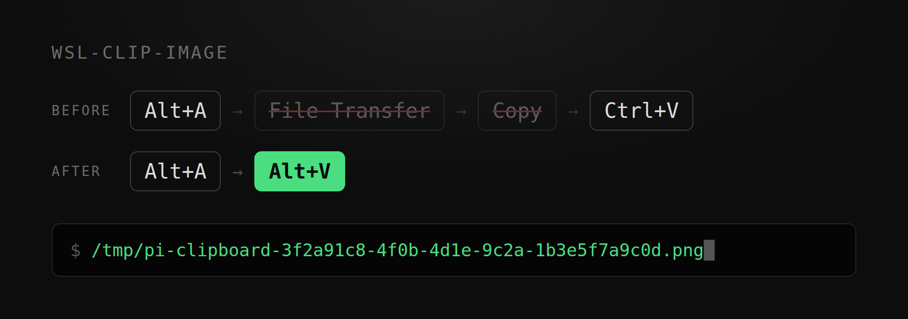

<h1 align="center">wsl-clip-image</h1>

<p align="center">
  <em>截圖，然後 <code>Alt+V</code>。就這樣。</em>
</p>

<p align="center">
  
  
  
  
</p>

<p align="center">
  <strong>四步變兩步。</strong><br>
  <strong>去掉的是「發到檔案傳輸」和「點複製」。</strong><br>
  <sub>Windows 11 · WSL2 Ubuntu · pi · 實測 82–125 ms</sub>
</p>

<p align="center">
  
</p>

<p align="center">
  <sub><a href="../README.md">English</a> &middot; <a href="README.zh-CN.md">简体中文</a> &middot; <a href="README.ja.md">日本語</a> &middot; <a href="README.ko.md">한국어</a> &middot; <a href="README.fr.md">Français</a> &middot; <a href="README.pt-BR.md">Português</a> &middot; <a href="README.ru.md">Русский</a></sub>
</p>

---

## 多出來的兩步

你想讓終端機裡的 AI 看一眼錯誤訊息。

`Alt+A`，框選，Enter。圖在剪貼簿裡了。

回到終端機，按 `Ctrl+V`。什麼都沒發生。

於是你打開 WeChat，找到檔案傳輸，把圖送過去。等它出現在聊天記錄裡，按滑鼠右鍵，點「複製」。

再回終端機，再按 `Ctrl+V`。這次有了——一行 `F:\xwechat_files\wxid_xxx\temp\RWTemp\...png`。

能用，AI 也讀得懂。但你為了一張截圖，開了個聊天軟體、送出一則訊息、點了一次複製。

## 裝好之後

```
Alt+A 截圖   →   Alt+V   →   /tmp/pi-clipboard-3f2a91c8-....png
```

按 `Alt+V`，程式自己去讀剪貼簿，寫成檔案，把路徑放進輸入框。

WeChat `Alt+A` 可以，Windows 內建的 `Win+Shift+S` 也可以。

## 安裝

```bash
sudo apt install -y wl-clipboard imagemagick
git clone https://github.com/emmett001/wsl-clip-image.git ~/.agents/skills/wsl-clip-image
```

之後：`Alt+A` → `Enter` → `Alt+V`。pi 會在下次啟動時載入這個 skill。

不用 pi 的，一行指令：

```console
$ git clone https://github.com/emmett001/wsl-clip-image.git
$ wsl-clip-image/scripts/grab.sh
/tmp/wslclip-20261106-174535-2946895.png
```

`grab.sh` 印出的是 Linux 路徑，`cat`、`identify`、`cp` 都能直接用。

## 能用在什麼環境

| | |
|-|-|
| 已實測 | Windows 11 · WSL2 Ubuntu · Windows Terminal · pi 1.5.0 |
| 已實測 | 同環境下由 `grab.sh` 供任何腳本呼叫 |
| 未驗證 | 其他 AI 代理、其他終端機、其他發行版、WSL1、原生 Linux、macOS |

`Alt+V` 是 pi 自己的鍵位。換代理，鍵位從哪裡來、認不認圖片路徑，都要重新確認。
`grab.sh` 依賴 bash 與系統指令，可攜性較寬，其餘環境尚未實測。

## 數字

同一張 1920x1020 截圖，同一台機器實測：

| 路徑 | 耗時 |
|-|-|
| `wl-paste`（pi 內部貼上） | 82–125 ms |
| `wl-paste` + ImageMagick（`grab.sh`） | 210 ms |
| PowerShell 備援 | 660–1709 ms |

`wl-clipboard` 是快慢的分界，差 5–17 倍。

## 貼不上時

```console
$ scripts/doctor.sh
== 1. WSL interop ==          正常  binfmt WSLInterop 已註冊
== 2. powershell.exe ==       正常  可執行
== 3. WSL 側剪貼簿工具 ==     正常  wl-paste 已裝，快速路徑可用：image/bmp
== 4. Windows 剪貼簿內容 ==   正常  取圖成功，82 ms
結論：通道可用
```

| 症狀 | 處理 |
|-|-|
| `Exec format error`，或 `xxx.exe: 1: MZ...: not found` | `scripts/doctor.sh --fix` |
| 報「剪貼簿裡沒有圖片」 | 截圖沒按 `Enter`，或快速鍵被別的程式搶走 |
| `Alt+V` 卡 1–2 秒 | `sudo apt install -y wl-clipboard` |
| 圖偶爾「過期」 | 提供剪貼簿的行程結束了，重新截圖 |

兩處容易記錯的地方：

| 常見的記法 | 實際發生的事 |
|-|-|
| 截圖會以檔案形式存進剪貼簿 | 存的是點陣圖。檔案路徑只在「送出後點複製」時出現 |
| 得先發到檔案傳輸才能貼 | 按下 `Enter` 完成的那一刻，剪貼簿就已經有了 |

## 不管什麼

剪貼簿歷史與搜尋、文字複製、把 WSL 裡的圖送回 Windows。

## 授權

[MIT](../LICENSE)
